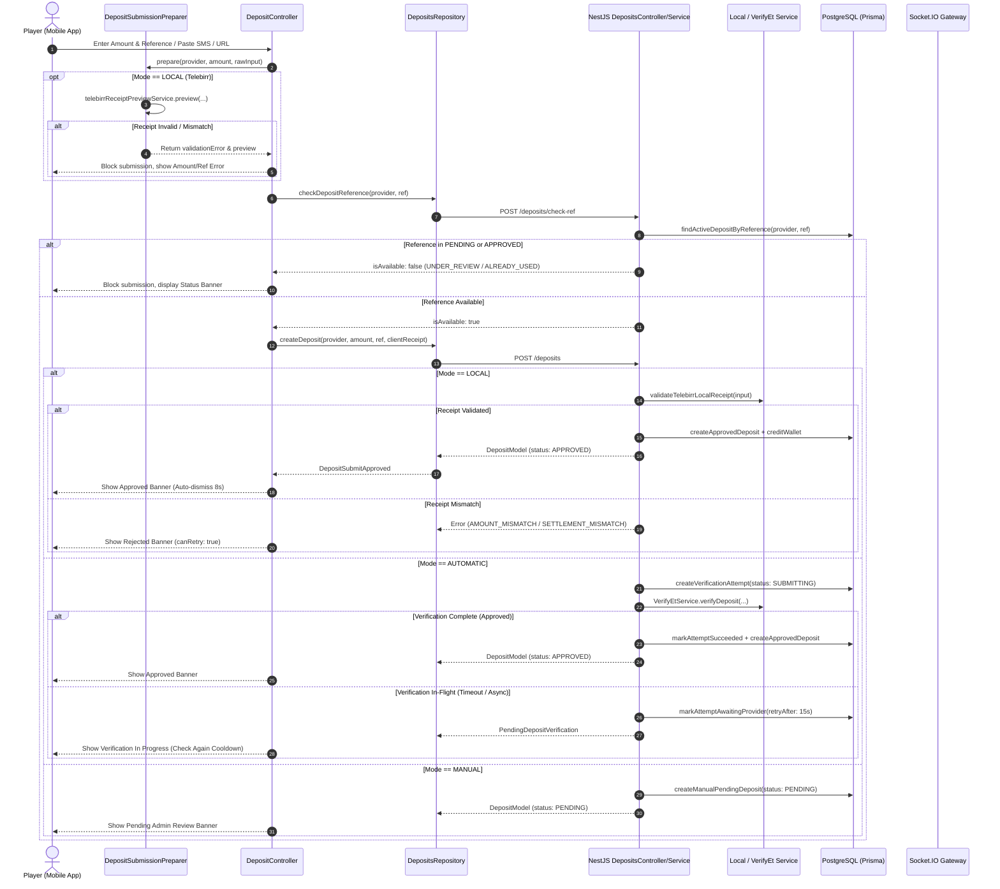
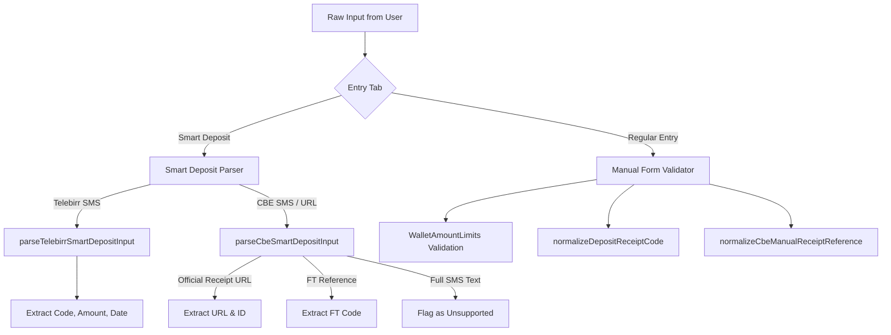

# Complete Deposit Flow & Checking Conditions Specification
**System Architecture & End-to-End Specification across Backend and Mobile App**
**Target Platforms:** NestJS API (`FriendsBingo-backend`) & Flutter Mobile Client (`friends-bingo-mobile`)
**Date:** October 26, 2026

---

## 1. Executive Summary & Provider-Mode Matrix

The Friends Bingo deposit system supports **4 payment providers** operating under **3 distinct approval/verification modes**. The platform enforces strict double-spend prevention, transactional wallet credits, automated or client-side receipt scraping, in-flight verification attempt tracking, and administrator PIN authorization.

### Provider vs. Approval Mode Compatibility

| Payment Provider | Allowed Modes (`getAllowedModes`) | Default Mode | Typical Verification Source |
| :--- | :--- | :--- | :--- |
| **`TELEBIRR`** (Ethio Telecom) | `LOCAL`, `AUTOMATIC`, `MANUAL` | `LOCAL` | `telebirr.local` (Client scraper) or `Verify.Et` (API) |
| **`CBE`** (Commercial Bank of Ethiopia) | `AUTOMATIC`, `MANUAL` | `AUTOMATIC` | `Verify.Et` (API) or Admin Dashboard |
| **`AWASH`** (Awash Bank) | `AUTOMATIC`, `MANUAL` | `AUTOMATIC` | `Verify.Et` (API) or Admin Dashboard |
| **`BOA`** (Bank of Abyssinia) | `AUTOMATIC`, `MANUAL` | `AUTOMATIC` | `Verify.Et` (API) or Admin Dashboard |

---

## 2. End-to-End Deposit Lifecycle (Sequence Architecture)



---

## 3. Deep-Dive: Checking Conditions by Approval Mode

### Mode 1: LOCAL Mode (Telebirr Only)
In `LOCAL` mode, trust is shifted to the phone to fetch the official receipt from Ethio Telecom's public portal (`https://transactioninfo.ethiotelecom.et/receipt/...`), parse the DOM, and submit structured evidence to the backend. The backend strictly cross-validates this evidence before wallet crediting.

#### A. Mobile Pre-Submission Validation (`TelebirrReceiptPreviewService`)
1. **Network Fetch:** Mobile executes HTTP GET to the official Telebirr receipt page.
2. **DOM / HTML Parsing:** Extracts:
   - `invoiceNumber` (matches transaction reference)
   - `settledAmount` (numeric amount paid)
   - `creditedPartyName` (receiver business name)
   - `creditedPartyAccountNo` (receiver phone or till number)
   - `transactionStatus` (must be `"completed"`)
3. **Client-Side Assertions:**
   - If `preview.status == amountMismatch`: Sets `amountServerError = "The receipt amount (X ETB) does not match your entered amount."`
   - If `preview.status == receiverMismatch`: Sets `transactionRefServerError = "This receipt was not paid to Friends Bingo account."`
   - If `preview.status == invalidReceipt`: Sets `transactionRefServerError = "This receipt is invalid or could not be verified."`
   - If `preview.status == previewUnavailable`: Sets `transactionRefServerError = "Unable to verify receipt right now. Please try again."`
   - **Hard Blocking:** In all above cases, client halts and never calls `createDeposit`.

#### B. Backend Server-Side Assertion (`validateTelebirrLocalReceipt`)
The backend does **not** blindly trust client payload. It executes strict cryptographic and logical assertions:
```typescript
// telebirr-local-receipt.validator.ts
1. receiptParseStatus === 'PARSED' && Boolean(clientReceipt)
   --> Failure: VERIFICATION_UNAVAILABLE
2. clientReceipt.transactionStatus.toLowerCase() === 'completed'
   --> Failure: INVALID_TRANSACTION
3. normalizeCode(clientReceipt.invoiceNumber).includes(normalizeCode(transactionRef))
   --> Failure: INVALID_TRANSACTION
4. Prisma.Decimal(clientReceipt.settledAmount).equals(requestedAmount)
   --> Failure: AMOUNT_MISMATCH
5. receiverMatches(configuredTelebirrAccounts, creditedPartyName, creditedPartyAccountNo)
   --> Failure: SETTLEMENT_MISMATCH
```
*Receiver Matching Condition:* The system resolves the configured settlement accounts. It extracts the last 4 digits of the account number or phone. If digits match, receiver is accepted; otherwise fallback matches normalized `receiverName`.

---

### Mode 2: AUTOMATIC Mode (Verify.ET Provider Integration)
Automatic mode integrates with the external `Verify.ET` banking aggregator to programmatically confirm that funds have arrived in the corporate bank or telecom account.

#### A. Supported Provider Request Payloads

| Provider | Verify.ET Bank Key | Request Payload Fields | Verification Criteria |
| :--- | :--- | :--- | :--- |
| **`TELEBIRR`** | `telebirr` | `transactionNumber`, `settlementAccount` | Iterates through dual settlement accounts (`TELEBIRR_SETTLEMENT_ACCOUNT` and `TELEBIRR_SETTLEMENT_ACCOUNT_2`). Stops on first match. |
| **`CBE`** | `cbe` | `referenceNumber`, `settlementAccount`, `accountSuffix`, `suffix` | Validates CBE reference against corporate account ending in 8-digit suffix (`CBE_ACCOUNT_SUFFIX`). Currency must be `ETB`. |
| **`AWASH`** | `awash` | `referenceNumber`, `settlementAccount` | Validates against `AWASH_SETTLEMENT_ACCOUNT`. |
| **`BOA`** | `abyssinia` | `referenceNumber`, `settlementAccount`, `accountSuffix` | Validates against corporate account ending in 5-digit suffix (`BOA_ACCOUNT_SUFFIX`). |

#### B. Verification Attempt State Machine
All automatic verification calls execute within a tracked database entity (`DepositVerificationAttempt`):

```
       [ Client Submits ]
              │
              ▼
        ( SUBMITTING )
              │
      ┌───────┴────────────────────────┐
      ▼                                ▼
[ Immediate Match ]          [ Timeout / Async Provider ]
      │                                │
      ▼                                ▼
 ( SUCCEEDED )               ( AWAITING_PROVIDER )
      │                                │
[ Wallet Credited ]            ┌───────┴───────────────┐
                               ▼                       ▼
                        [ User Polling ]      [ Expired (>15m) ]
                               │                       │
                               ▼                       ▼
                         ( AMBIGUOUS )             ( EXPIRED )
```

1. **`SUBMITTING`:** Locked exclusively to prevent concurrent worker/client execution on the same receipt reference.
2. **`AWAITING_PROVIDER`:** Set when Verify.ET returns HTTP 202 or pending status, or initial polling window (5 polls) elapses. Returns `PendingDepositVerification` to mobile with `retryAfterSeconds` (5 to 15 seconds).
3. **`AMBIGUOUS`:** Set if network drop occurs during initial post before `providerRequestId` could be saved, allowing safe recovery on resume.
4. **`SUCCEEDED`:** Verify.ET confirms transaction amount and settlement match. Transactionally credits wallet and marks attempt closed.
5. **`FAILED`:** Provider explicitly declares transaction invalid, non-existent, amount mismatch, or receiver mismatch.
6. **`EXPIRED`:** If an attempt remains unresolved after its timeout (`expiresAt`, default 15 minutes), it is expired, freeing the receipt for retry or player cancellation.

#### C. In-Flight Client "Check Again" Loop
- When an attempt is pending, mobile displays [`DepositConfirmationBanner`](file:///d:/FILES/SELF/BINGO/friends-bingo-mobile/lib/src/features/wallet/deposits/presentation/widgets/deposit_confirmation_banner.dart) with a cooldown timer.
- Button is disabled until `checkAgainAvailableAt` arrives.
- Tapping **"Check Again"** invokes [`DepositController.checkPendingVerification()`](file:///d:/FILES/SELF/BINGO/friends-bingo-mobile/lib/src/features/wallet/deposits/application/controllers/deposit_controller.dart#L389-L519).
- Calls backend `POST /deposits/verification-attempts/:attemptId/check`.
- Backend resumes the existing Verify.ET query using saved `providerRequestId` without double-charging API credits.

---

### Mode 3: MANUAL Mode (Administrator PIN Verification)
When a provider is configured for `MANUAL` approval (or CBE manual mode), deposits require staff inspection.

1. **Submission:**
   - Mobile normalizes receipt reference (or CBE manual receipt URL).
   - Backend creates deposit row with `status: PENDING` and `parseStatus: MANUAL_PENDING`.
   - Realtime event `deposit:created` is dispatched to the admin dashboard.
2. **Admin Review & PIN Gate:**
   - Admin verifies deposit receipt against bank portal.
   - Admin approves deposit by submitting their secret 4-digit PIN:
     `POST /admin/deposits/:id/approve` with `{ "approvalPin": "****" }`.
   - Backend compares `approvalPin` against `ADMIN_MANUAL_APPROVAL_PIN` in constant-time.
   - On match: Prisma transaction sets `status: APPROVED`, records `approvedAt`, and calls `WalletService.creditDeposit`.
3. **Admin Rejection:**
   - Admin calls `POST /admin/deposits/:id/reject` with `{ "rejectionReason": "..." }`.
   - Backend sets `status: REJECTED`, stores rejection reason, and notifies player.
   - Player's mobile app receives realtime socket update, displaying rejection reason with **"Fix and Resubmit"** option.

---

## 4. Mobile Input Normalization & Parsing Engine



### Parser Rules & Normalization

1. **Telebirr SMS Parser:**
   - Extracts 10-character uppercase alphanumeric transaction code.
   - Extracts numeric amount formatted with commas/decimals.
   - Rejects text from other telecom or banking formats.
2. **CBE Smart Parser & Manual Normalizer:**
   - Recognizes official CBE receipt URLs matching `kDefaultCbeReceiptBaseUrl` (`https://apps.cbe.com.et:100/?id=...`).
   - Normalizes raw URLs to canonical reference ID while preserving the full URL for manual review.
   - Extracts legacy FT codes matching `^FT\d{10}$`.
   - Specifically flags unverified full CBE SMS texts as unsupported, instructing the user to paste the receipt URL instead.

---

## 5. Double-Spend & Concurrency Protection Engine

The system implements 3 layers of double-spend defense:

1. **Client-Side Pre-Flight Check:**
   - Before submitting `POST /deposits`, mobile calls `POST /deposits/check-ref`.
   - Checks if reference is already registered or in-flight.
   - If unavailable, halts immediately without hitting the heavy verification pipeline.
2. **Service Layer Assertion (`ensureReferenceAvailable`):**
   - Queries `prisma.deposit.findFirst` for matching `provider` + `transactionRef`.
   - If existing deposit is `PENDING`: throws `ConflictException('UNDER_REVIEW')`.
   - If existing deposit is `APPROVED`: throws `ConflictException('ALREADY_USED')`.
   - Queries active verification attempts: if in-flight by another user, throws `UNDER_REVIEW`.
3. **Database Unique Constraint (`P2002`):**
   - Prisma schema enforces `@@unique([provider, transactionRef])` on the `Deposit` model.
   - Any race condition that slips past application locks fails at the database level and is caught by the Prisma exception filter, throwing `ALREADY_USED`.

---

## 6. Comprehensive Error Taxonomy & UI Mapping

| Error Code | HTTP Status | Originating Cause | Mobile UI Banner Kind | Mobile Field Error Target | User Can Retry? |
| :--- | :--- | :--- | :--- | :--- | :--- |
| **`ALREADY_USED`** | 409 Conflict | Receipt already credited in database | `DepositConfirmationKind.rejected` | `transactionRefServerError` | **No** (`canRetry: false`) |
| **`UNDER_REVIEW`** | 409 Conflict | Receipt currently pending admin or in-flight verification | `DepositConfirmationKind.underReview` | `transactionRefServerError` | **No** (`canRetry: false`) |
| **`AMOUNT_MISMATCH`** | 400 Bad Request | Paid amount does not match submitted form amount | `DepositConfirmationKind.rejected` | `amountServerError` | **Yes** (`canRetry: true`) |
| **`SETTLEMENT_MISMATCH`** | 400 Bad Request | Funds paid to another phone number or company | `DepositConfirmationKind.rejected` | `transactionRefServerError` | **Yes** (`canRetry: true`) |
| **`RECEIVER_MISMATCH`** | 400 Bad Request | Receiver name does not match Friends Bingo | `DepositConfirmationKind.rejected` | `transactionRefServerError` | **Yes** (`canRetry: true`) |
| **`INVALID_RECEIPT`** | 400 Bad Request | Scraped HTML receipt is empty, cancelled, or corrupted | `DepositConfirmationKind.rejected` | `transactionRefServerError` | **Yes** (`canRetry: true`) |
| **`INVALID_TRANSACTION`**| 400 Bad Request | Bank or Verify.ET reports transaction not found | `DepositConfirmationKind.rejected` | `transactionRefServerError` | **Yes** (`canRetry: true`) |
| **`VERIFICATION_PENDING`**| 400 Bad Request | Automated provider is processing; result not ready | `DepositConfirmationKind.verificationInProgress` | None (Shows Cooldown) | **Yes** (Via "Check Again") |
| **`VERIFICATION_UNAVAILABLE`**| 400 / 503 | External telecom / bank API is temporarily down | `DepositConfirmationKind.verificationInProgress` | None (Shows Cooldown) | **Yes** (Via "Check Again") |

---

## 7. Realtime Synchronization & App State Restoration

1. **WebSocket Realtime Updates:**
   - Both backend and mobile listen on `wallet:updated` and `wallet:entity:update`.
   - When a deposit transitions to `APPROVED` or `REJECTED` in the background (e.g., admin approvals or delayed Verify.ET webhook resolutions):
     - Mobile matches `update.id == trackedDepositId` or `update.transactionRef == pendingRef`.
     - Automatically transitions confirmation banner from `pending` or `verificationInProgress` to `approved` or `rejected`.
     - Approved deposits trigger automatic wallet balance refresh (`myWalletProvider`) and dismiss after 8 seconds.
2. **Cold Start & Screen Restoration:**
   - If user exits the app while an automatic verification is pending:
     - On reopen, [`restorePendingVerificationAttempt()`](file:///d:/FILES/SELF/BINGO/friends-bingo-mobile/lib/src/features/wallet/deposits/application/controllers/deposit_controller.dart#L325-L389) reads persistent local storage (`readPendingDepositAttempt`).
     - Queries `GET /deposits/verification-attempts/active`.
     - Automatically restores in-flight verification state and re-engages the "Check Again" cooldown timer.
