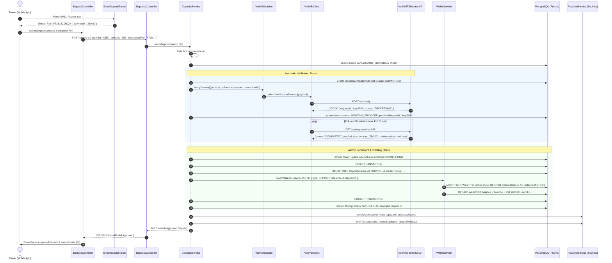
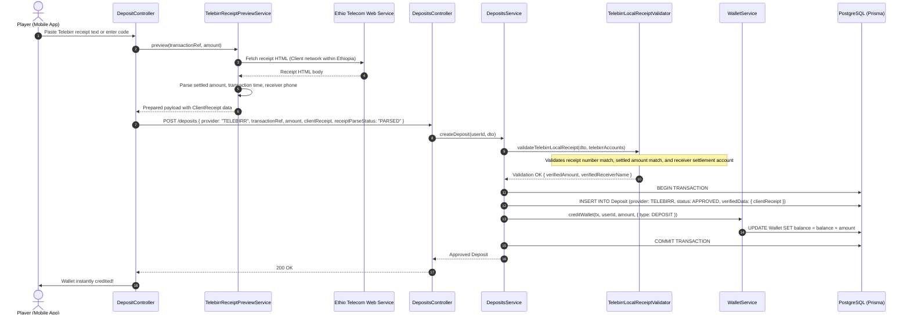
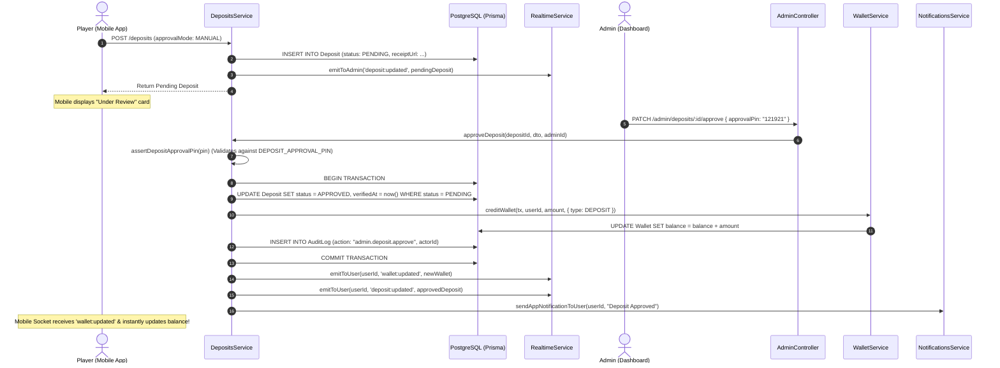
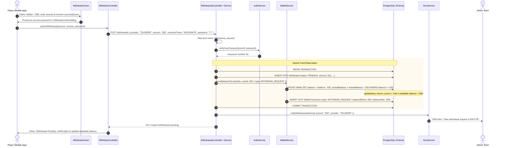
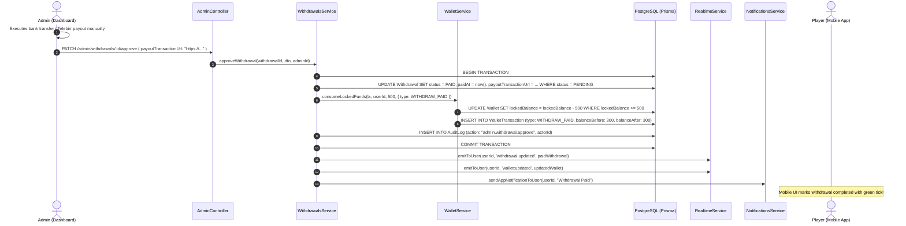
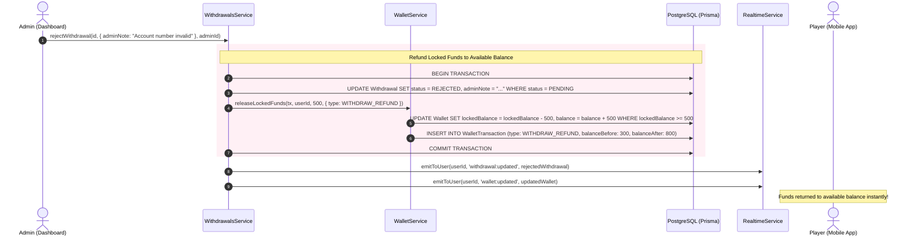

# Complete Money Transfer Flow & Architecture Specification
**FriendsBingo Mobile (Flutter/Riverpod) & FriendsBingo Backend (NestJS/Prisma/PostgreSQL)**

---

## 1. Executive Summary & System Overview

In the **FriendsBingo** gaming ecosystem, money transfers represent the critical financial backbone. Operating in Ethiopia with the Ethiopian Birr (ETB), the platform manages real-money transactions across four primary Ethiopian financial institutions:
- **Telebirr** (Ethio Telecom Mobile Money)
- **CBE** (Commercial Bank of Ethiopia / CBE Birr)
- **Awash Bank**
- **Bank of Abyssinia (BOA)**

The money transfer architecture spans three operational categories:
1. **Inbound Money Transfers (Deposits & Wallet Crediting)**: Players transfer ETB via USSD, mobile banking apps, or bank branches to platform settlement accounts, submitting proof via SMS smart parsing, official receipt URLs, or transaction IDs. Depending on configuration, deposits are verified and credited **Automatically** (via external verification service `Verify.ET`), **Locally** (via mobile client-side receipt parsing for Telebirr), or **Manually** (via Admin Dashboard with 6-digit PIN authorization).
2. **Outbound Money Transfers (Withdrawals & Payouts)**: Players request fund payouts to Telebirr or CBE. The system verifies the user's account password, moves the requested sum from `balance` to `lockedBalance` (preventing double spending during games), notifies admins via SMS, and upon admin payout execution with proof URL, consumes the locked funds and marks the transaction `PAID`. If rejected, locked funds are safely refunded.
3. **Internal Double-Entry Ledger (`WalletService`)**: Every transfer creates an immutable ledger row (`WalletTransaction`) recording `balanceBefore`, `balanceAfter`, `type`, `referenceType`, and `referenceId`. All balance mutations use atomic conditional database updates to ensure zero balance overdrafts under concurrent load.

```
       MOBILE APP (Flutter)                              BACKEND (NestJS)                         EXTERNAL & DB
┌─────────────────────────────────┐           ┌─────────────────────────────────────┐      ┌─────────────────────────┐
│ • DepositScreen / Smart Parser  │           │ • DepositsController                │      │ • Verify.ET API         │
│ • WithdrawScreen / Password Dlg │ ──HTTP──► │ • WithdrawalsController             │ ───► │ • Ethio Telecom HTTP    │
│ • Riverpod Controllers          │           │ • WalletService (Ledger Engine)     │      │ • PostgreSQL (Prisma)   │
│ • Socket Listener & Persistence │ ◄─WSS/FCM─│ • RealtimeService & Push Service    │      │ • Redis / Throttler     │
└─────────────────────────────────┘           └─────────────────────────────────────┘      └─────────────────────────┘
```

---

## 2. Component Topology & Architecture Breakdown

### 2.1 Backend Topology (`FriendsBingo-backend`)

The backend follows NestJS modular Clean Architecture with strict layer isolation:

```
                      Client HTTP Requests / WebSocket Connections
                                          │
                                          ▼
                      ┌──────────────────────────────────────┐
                      │   Guards, Throttlers & Decorators    │
                      │  • JwtAuthGuard, RolesGuard          │
                      │  • UserActionRateLimitService        │
                      └──────────────────┬───────────────────┘
                                         │
                                         ▼
                      ┌──────────────────────────────────────┐
                      │          Controller Layer            │
                      │  • DepositsController                │
                      │  • WithdrawalsController             │
                      │  • AdminController                   │
                      └──────────────────┬───────────────────┘
                                         │
                                         ▼
                      ┌──────────────────────────────────────┐
                      │           Service Layer              │
                      │  • DepositsService (Workflow Engine) │
                      │  • WithdrawalsService (Payout Mgmt)  │
                      │  • VerifyEtService / VerifyEtClient  │
                      │  • TelebirrLocalReceiptValidator     │
                      │  • DepositApprovalConfigService      │
                      └──────────────────┬───────────────────┘
                                         │
                                         ▼
                      ┌──────────────────────────────────────┐
                      │      Ledger & Domain Core Layer      │
                      │  • WalletService (Locking, Credits,  │
                      │    Debits, Idempotency, Invariants)  │
                      └──────────────────┬───────────────────┘
                                         │
                   ┌─────────────────────┴─────────────────────┐
                   ▼                                           ▼
      ┌───────────────────────────┐               ┌───────────────────────────┐
      │  Database Tier (Prisma)   │               │ Event & Notification Tier │
      │  • PostgreSQL DB          │               │ • RealtimeService (WS)    │
      │  • Serializable Txns      │               │ • NotificationsService    │
      │  • Atomic conditional sql │               │ • SmsService (Admin SMS)  │
      └───────────────────────────┘               └───────────────────────────┘
```

### 2.2 Mobile Topology (`friends-bingo-mobile`)

The mobile client is structured using Flutter with Riverpod, following Domain-Driven Design (DDD) principles:

```
                      ┌──────────────────────────────────────────────┐
                      │              Presentation Layer              │
                      │  • DepositScreen / WithdrawScreen            │
                      │  • DepositSmartSection / ManualSection       │
                      │  • WithdrawConfirmDialog / StatusCards       │
                      │  • DepositSettlementAccountCard (Copy tools) │
                      └──────────────────────┬───────────────────────┘
                                             │
                                             ▼
                      ┌──────────────────────────────────────────────┐
                      │              Application Layer               │
                      │  • DepositController (AsyncNotifier)         │
                      │  • WithdrawController (Notifier)             │
                      │  • WalletProvider / TransactionsProvider     │
                      │  • Cooldown & Auto-Dismiss Timers            │
                      └──────────────────────┬───────────────────────┘
                                             │
                         ┌───────────────────┴───────────────────┐
                         ▼                                       ▼
        ┌────────────────────────────────┐      ┌────────────────────────────────┐
        │          Domain Layer          │      │           Data Layer           │
        │ • CbeSmartDepositParser        │      │ • DepositsRepository           │
        │ • TelebirrSmartDepositParser   │      │ • WithdrawalsRepository        │
        │ • DepositSubmissionPreparer    │      │ • TelebirrPreviewService       │
        │ • WalletValidationUtils        │      │ • AppPreferencesStorage (Disk) │
        └────────────────────────────────┘      └────────────────────────────────┘
```

---

## 3. Inbound Money Transfer (Deposit) Detailed Flows

The platform supports 3 distinct approval modes for deposits, configured per provider via `DepositApprovalConfig`:

| Approval Mode | Supported Providers | Verification Mechanism | User Experience |
| :--- | :--- | :--- | :--- |
| **`AUTOMATIC`** | Telebirr, CBE, Awash, BOA | Real-time external query via `Verify.ET` API & background polling | Instant credit (3-15s), with "Check Again" fallback |
| **`LOCAL`** | Telebirr only | Flutter fetches and parses receipt directly, server cryptographically/semantically validates | Instant credit, bypasses foreign VPS IP restrictions |
| **`MANUAL`** | All Providers (Telebirr, CBE, Awash, BOA) | Admin verifies settlement in bank statement, enters 6-digit approval PIN | Asynchronous review, real-time push upon approval |

---

### 3.1 Flow A: Automatic Deposit Verification (`Verify.ET`)

When a user deposits money and submits the reference, the system queries `Verify.ET`. If the provider takes time to respond, it returns a pending verification state with a cooldown timer, allowing non-blocking retries.



---

### 3.2 Flow B: Local Telebirr Receipt Verification (Client-Led)

Foreign servers hosting backend code may face geo-blocking or CAPTCHA restrictions when connecting directly to Ethio Telecom servers. The **Local Telebirr Flow** delegates the initial HTTP receipt fetch to the Flutter client within Ethiopia, validating the parsed payload on the backend.



---

### 3.3 Flow C: Manual Admin Approval Flow (with 6-Digit PIN)

When a bank does not support automated API verification or when a transaction is flagged for human review, the deposit enters the manual verification pipeline.



---

## 4. Outbound Money Transfer (Withdrawal) Detailed Flows

The withdrawal pipeline executes strict security and accounting guarantees:
1. **Password Authentication**: Re-verifies user password on every request.
2. **Atomic Fund Locking**: Debits `balance` and credits `lockedBalance`. The player cannot wager these funds while awaiting payout.
3. **Admin Payout with Proof**: Requires proof URL/reference before marking `PAID` and consuming locked funds.
4. **Complete Reversibility**: Rejection or failure returns funds safely back to available balance.

---

### 4.1 Withdrawal Request & Fund Locking



---

### 4.2 Admin Payout Execution (`approveWithdrawal`)



---

### 4.3 Withdrawal Rejection & Safe Refund (`rejectWithdrawal`)



---

## 5. Core Ledger Engine: `WalletService` Analysis

The wallet engine is implemented in [`wallet.service.ts`](file:///d:/FILES/SELF/BINGO/FriendsBingo-backend/src/wallet/wallet.service.ts). It enforces mathematical and transactional integrity for all balance movements.

### 5.1 Balance Mutation Modes

```typescript
type WalletMutationDirection = 'CREDIT' | 'DEBIT';
type WalletMutationBalanceMode =
  | 'AVAILABLE'              // Normal credits/debits directly affecting wallet.balance
  | 'AVAILABLE_TO_LOCKED'    // Moves balance -> lockedBalance (used in WITHDRAW_REQUEST)
  | 'LOCKED_TO_AVAILABLE'    // Moves lockedBalance -> balance (used in WITHDRAW_REFUND)
  | 'LOCKED_ONLY';           // Debits lockedBalance directly (used in WITHDRAW_PAID)
```

### 5.2 Atomic Conditional Invariants

To avoid database locking deadlocks while guaranteeing no overdrafts under massive concurrent load, `WalletService` executes atomic conditional updates:

```typescript
const updateResult = await db.wallet.updateMany({
  where: {
    userId,
    ...(plan.minimumAvailableBalance ? { balance: { gte: plan.minimumAvailableBalance } } : {}),
    ...(plan.minimumLockedBalance ? { lockedBalance: { gte: plan.minimumLockedBalance } } : {}),
  },
  data: plan.data,
});

if (updateResult.count !== 1) {
  throw new BadRequestException('Insufficient balance');
}
```

If multiple threads or requests race to spend the same balance, exactly one transaction will succeed in decrementing; the others fail atomically.

---

## 6. Mobile Smart Parsing Subsystem Analysis

In `friends-bingo-mobile`, players do not need to manually decipher complicated banking SMS text.

### 6.1 CBE Smart Deposit Parser (`cbe_smart_deposit_parser.dart`)
Supports two patterns:
1. **SMS Message Parsing**:
   Regex parses strings such as:
   `"You have transferred ETB 250.00 to Friends Bingo. Txn ID: FT26152ZN0XY."`
   Extracts `amount = 250.00`, `reference = FT26152ZN0XY`.
2. **Official Receipt URL Parsing**:
   Extracts transaction code from URLs like:
   `https://apps.cbe.com.et:8443/receipt/...` or formats it to normalize the manual receipt reference.

### 6.2 Telebirr Smart Deposit Parser (`telebirr_smart_deposit_parser.dart`)
1. **SMS / Transaction Text**:
   Parses strings such as:
   `"You have paid ETB 100.00 to FRIENDS BINGO (09...)... Transaction number: 26032014112345."`
   Extracts `settledAmount` and `transactionRef`.
2. **Preview Verification**:
   Validates whether the destination phone/account matches the active settlement account of the platform.

---

## 7. Database Schemas & Data Contracts

### 7.1 Prisma Enums
```prisma
enum PaymentProvider {
  CBE
  TELEBIRR
  AWASH
  BOA
}

enum DepositStatus {
  PENDING
  APPROVED
  REJECTED
}

enum WithdrawStatus {
  PENDING
  APPROVED
  PAID
  REJECTED
  FAILED
  REFUNDED
}

enum WalletTransactionType {
  DEPOSIT
  WITHDRAW_REQUEST
  WITHDRAW_PAID
  WITHDRAW_REFUND
  GAME_ENTRY
  PRIZE_WIN
  REFUND
  ADMIN_ADJUSTMENT
}

enum DepositApprovalMode {
  AUTOMATIC
  MANUAL
  LOCAL
}

enum DepositVerificationAttemptStatus {
  SUBMITTING
  AWAITING_PROVIDER
  SUCCEEDED
  FAILED
  EXPIRED
  AMBIGUOUS
}
```

### 7.2 Prisma Models

```prisma
model Wallet {
  id                  String              @id @default(uuid())
  userId              String              @unique
  balance             Decimal             @default(0) @db.Decimal(12, 2)
  lockedBalance       Decimal             @default(0) @db.Decimal(12, 2)
  bonusCartelaBalance Int                 @default(0)
  createdAt           DateTime            @default(now())
  updatedAt           DateTime            @updatedAt
  transactions        WalletTransaction[]
  user                User                @relation(fields: [userId], references: [id], onDelete: Cascade)
}

model WalletTransaction {
  id            String                @id @default(uuid())
  walletId      String
  userId        String
  type          WalletTransactionType
  amount        Decimal               @db.Decimal(12, 2)
  balanceBefore Decimal               @db.Decimal(12, 2)
  balanceAfter  Decimal               @db.Decimal(12, 2)
  referenceType String
  referenceId   String
  description   String?
  createdAt     DateTime              @default(now())
  wallet        Wallet                @relation(fields: [walletId], references: [id], onDelete: Cascade)
  user          User                  @relation(fields: [userId], references: [id], onDelete: Cascade)

  @@index([userId, createdAt])
  @@index([referenceType, referenceId])
}

model Deposit {
  id                   String          @id @default(uuid())
  userId               String
  provider             PaymentProvider
  amount               Decimal         @db.Decimal(12, 2)
  transactionRef       String
  receiptUrl           String?
  status               DepositStatus   @default(PENDING)
  verifiedAt           DateTime?
  rejectionReason      String?
  verifiedAmount       Decimal?        @db.Decimal(12, 2)
  verifiedReceiverName String?
  verifiedData         Json?
  walletTransactionId  String?
  createdAt            DateTime        @default(now())
  updatedAt            DateTime        @updatedAt
  user                 User            @relation(fields: [userId], references: [id], onDelete: Cascade)

  @@unique([provider, transactionRef])
  @@index([userId, status])
}

model Withdrawal {
  id                   String          @id @default(uuid())
  userId               String
  provider             PaymentProvider
  amount               Decimal         @db.Decimal(12, 2)
  receiverPhone        String?
  receiverAccount      String?
  payoutRef            String?
  payoutTransactionUrl String?
  status               WithdrawStatus  @default(PENDING)
  paidAt               DateTime?
  adminNote            String?
  createdAt            DateTime        @default(now())
  updatedAt            DateTime        @updatedAt
  user                 User            @relation(fields: [userId], references: [id], onDelete: Cascade)

  @@index([userId, status])
  @@index([status, createdAt])
}

model DepositVerificationAttempt {
  id                String                           @id @default(uuid())
  userId            String
  provider          PaymentProvider
  amount            Decimal                          @db.Decimal(12, 2)
  transactionRef    String
  providerRequestId String?
  correlationId     String?
  status            DepositVerificationAttemptStatus @default(SUBMITTING)
  expiresAt         DateTime
  depositId         String?
  lastErrorCode     String?
  lastErrorMessage  String?
  createdAt         DateTime                         @default(now())
  updatedAt         DateTime                         @updatedAt

  @@index([provider, transactionRef])
  @@index([userId, status])
}
```

---

## 8. Concurrency, Edge Cases & Security Posture

| Risk / Attack Vector | Mitigation in FriendsBingo Architecture |
| :--- | :--- |
| **Double Credit on Fast Double Tap** | Client disables submit button while `isSubmitting: true`. Backend asserts unique index on `[provider, transactionRef]`. If already approved, returns existing approved record idempotently without re-crediting. |
| **Concurrent "Check Again" Spamming** | Backend uses atomic claim: `updateMany({ where: { id: attempt.id, NOT: { lastErrorCode: 'COMPLETING' } }, data: { lastErrorCode: 'COMPLETING' } })`. Losers receive pending state without initiating duplicate credits. |
| **Withdrawal Double-Spending** | Balance is immediately shifted to `lockedBalance` inside a single Prisma serializable transaction. If available balance < requested amount, SQL condition `balance >= amount` rejects atomically. |
| **Unauthorized Admin Deposit Approvals** | All manual deposit approvals require a 6-digit secret admin PIN verified via `assertDepositApprovalPin(pin)`. Audit log records `actorId`, timestamp, and full metadata. |
| **Unauthorized Withdrawal Submissions** | Player must re-enter their plaintext account password, verified against Argon2/Bcrypt hash via `AuthService.verifyUserPassword`. |
| **Mobile App Killed Mid-Verification** | `DepositController` writes active attempts to local disk storage (`AppPreferencesStorage.writePendingDepositAttempt`). On relaunch, `restorePendingVerificationAttempt()` polls `GET /deposits/verification-attempts/active`. |
| **Foreign VPS IP Blocks (Ethio Telecom)** | Handled via **`LOCAL`** approval mode: mobile client in Ethiopia directly fetches the Telebirr HTML receipt and forwards parsed fields to backend for verification. |

---

## 9. Key File Index & Reference Links

### Backend Files (`FriendsBingo-backend`)
- [deposits.controller.ts](file:///d:/FILES/SELF/BINGO/FriendsBingo-backend/src/deposits/deposits.controller.ts): Player deposit endpoints (`POST /deposits`, `POST /check-ref`, `GET /verification-attempts/active`, `POST /verification-attempts/:id/check`).
- [deposits.service.ts](file:///d:/FILES/SELF/BINGO/FriendsBingo-backend/src/deposits/deposits.service.ts): Core deposit workflow engine, automatic verification lifecycle, local Telebirr receipt validator, and manual approval handlers.
- [withdrawals.controller.ts](file:///d:/FILES/SELF/BINGO/FriendsBingo-backend/src/withdrawals/withdrawals.controller.ts): Player withdrawal endpoints (`POST /withdrawals`, `GET /withdrawals/me`).
- [withdrawals.service.ts](file:///d:/FILES/SELF/BINGO/FriendsBingo-backend/src/withdrawals/withdrawals.service.ts): Withdrawal creation, balance locking, admin payout processing, rejection, and fund refunding.
- [wallet.service.ts](file:///d:/FILES/SELF/BINGO/FriendsBingo-backend/src/wallet/wallet.service.ts): Double-entry ledger core, atomic conditional balance mutations, credit, debit, lock, and unlock mechanisms.
- [verify-et.service.ts](file:///d:/FILES/SELF/BINGO/FriendsBingo-backend/src/verify-et/verify-et.service.ts): Integration with Ethiopian payment verification service (`Verify.ET`), settlement account matching, and polling logic.
- [admin.controller.ts](file:///d:/FILES/SELF/BINGO/FriendsBingo-backend/src/admin/admin.controller.ts): Admin deposit approval with PIN (`PATCH /admin/deposits/:id/approve`) and withdrawal payout (`PATCH /admin/withdrawals/:id/approve`).
- [schema.prisma](file:///d:/FILES/SELF/BINGO/FriendsBingo-backend/prisma/schema.prisma): Complete database schema definitions for Wallet, WalletTransaction, Deposit, Withdrawal, and DepositVerificationAttempt.

### Mobile App Files (`friends-bingo-mobile`)
- [deposit_controller.dart](file:///d:/FILES/SELF/BINGO/friends-bingo-mobile/lib/src/features/wallet/deposits/application/controllers/deposit_controller.dart): Riverpod controller managing deposit state machine, smart parsing, submission, real-time socket updates, and recovery persistence.
- [deposit_screen.dart](file:///d:/FILES/SELF/BINGO/friends-bingo-mobile/lib/src/features/wallet/deposits/presentation/screens/deposit_screen.dart): Deposit UI screen featuring provider selector, copyable settlement cards, smart/manual tabs, and status banners.
- [deposit_submission_preparer.dart](file:///d:/FILES/SELF/BINGO/friends-bingo-mobile/lib/src/features/wallet/deposits/domain/utils/deposit_submission_preparer.dart): Normalizes reference codes, validates URLs, and prepares client receipt payloads.
- [cbe_smart_deposit_parser.dart](file:///d:/FILES/SELF/BINGO/friends-bingo-mobile/lib/src/features/wallet/deposits/domain/parsers/cbe_smart_deposit_parser.dart): Regex parser for CBE SMS texts and official receipt URLs.
- [telebirr_smart_deposit_parser.dart](file:///d:/FILES/SELF/BINGO/friends-bingo-mobile/lib/src/features/wallet/deposits/domain/parsers/telebirr_smart_deposit_parser.dart): Regex parser for Telebirr transaction text and receipt codes.
- [withdraw_controller.dart](file:///d:/FILES/SELF/BINGO/friends-bingo-mobile/lib/src/features/wallet/withdrawals/application/controllers/withdraw_controller.dart): Riverpod controller managing withdrawal submission, CBE account memory, and real-time approval/rejection updates.
- [withdraw_screen.dart](file:///d:/FILES/SELF/BINGO/friends-bingo-mobile/lib/src/features/wallet/withdrawals/presentation/screens/withdraw_screen.dart): Withdrawal UI screen with balance limits, provider picker, and confirm dialog.
- [withdraw_confirm_dialog.dart](file:///d:/FILES/SELF/BINGO/friends-bingo-mobile/lib/src/features/wallet/withdrawals/presentation/widgets/withdraw_confirm_dialog.dart): Security modal requiring account password confirmation prior to submitting a withdrawal.
- [wallet_screen.dart](file:///d:/FILES/SELF/BINGO/friends-bingo-mobile/lib/src/features/wallet/overview/presentation/screens/wallet_screen.dart): Wallet overview displaying available, locked, and bonus balances.
