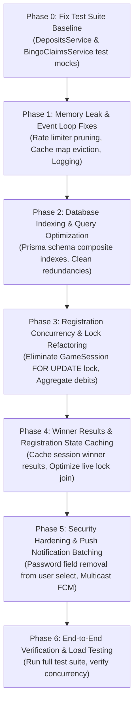

# Friends Bingo Backend — Comprehensive End-to-End Audit & Production Optimization Plan

**Date:** November 1, 2026  
**Target Codebase:** `Friends-bingo-backend` (NestJS 11 + Prisma 7 + PostgreSQL 16 + Socket.IO + Redis)  
**Scope:** Complete Backend System Architecture, Database Design, Concurrency, Performance, Scalability, and Reliability.

---

## 1. Executive Summary

A comprehensive architectural, code quality, database, concurrency, and performance audit of the Friends Bingo backend was conducted. The codebase exhibits strong foundational patterns (strict TypeScript, Prisma ORM, pessimistic row locking on critical transitions, automated Verify.ET payment pipelines, and Prometheus metrics). 

However, under real-time conditions with **high player concurrency** (e.g., hundreds to thousands of simultaneous players registering, purchasing cartelas, streaming called balls, and submitting bingo claims), several **critical bottlenecks, memory leaks, serialization hazards, and redundant database operations** will severely degrade performance, exhaust database connections, and introduce latency spikes.

This document details all confirmed findings across 10 architectural categories and provides a structured, safe, multi-phase plan to optimize the entire backend without breaking API contracts, changing business rules, or altering working functionality.

---

## 2. Architecture & High-Concurrency System Profile

| Component | Current Implementation | Production Scalability Bottleneck |
|-----------|------------------------|-----------------------------------|
| **Game State Machine** | Canonical `GameSlot` & `GameSession` in PostgreSQL | Exclusive row lock on `GameSession` serializes all registrations |
| **Schedulers & Loops** | In-process `setInterval` timers (10 separate services) | Independent timers across multi-instance deployments create lock collisions; polling overhead |
| **Realtime Engine** | Socket.IO with optional `@socket.io/redis-adapter` | Defaults to in-memory adapter; DB user lookups on every handshake and room join |
| **Financial Ledger** | Two-phase balance lock + atomic decrement in PostgreSQL | 5 database queries per cartela purchase; 100 queries in a bulk-20 chunk |
| **Cache Layer** | In-memory `Map` with custom TTL & generational coalescing | Memory leaks from non-evicting maps; redundant logging on hot paths |
| **Push Notifications** | Firebase Admin SDK (FCM) | Sequential individual sends instead of multicast; unbatched user queries |

---

## 3. Detailed Audit Findings by Category

### Category A: Concurrency & Transaction Bottlenecks (Critical Severity)

#### A1. Exclusive `GameSession` Row Lock Serializes All Concurrent Registrations
- **Location:** `src/games/games.service.ts` (`getSessionForRegistrationWrite`, line ~6861)
- **Mechanism:** Every cartela registration (single or bulk) calls `lockGameSessionRow(tx, sessionId)`, issuing `SELECT id FROM "GameSession" WHERE id = ${sessionId} FOR UPDATE`.
- **Impact:** When 50–100 players concurrently register during a 180s registration countdown, every player is serialized behind a single row lock. A bulk registration taking 200–500ms will queue other players, causing connection pool exhaustion and transaction timeouts (`maxWait: 10_000ms`).
- **Root Cause:** Lock was added to protect `prizeAmount` increments and `status === 'READY'`, even though:
  1. Cartela conflict prevention is already enforced at the database level by the unique constraint `@@unique([gameSessionId, cartelaId])`.
  2. `prizeAmount` and `companyRevenue` updates can be performed via atomic increments (`UPDATE ... SET prizeAmount = prizeAmount + delta WHERE id = ... AND status = 'READY'`).

#### A2. N+1 Database Round-trips in Bulk Registration Chunk Processing
- **Location:** `src/games/games.service.ts` (`registerCartelasBulkChunkWithRetry`, lines ~2081–2260)
- **Mechanism:** For each cartela in a chunk (up to 20 cartelas):
  1. `tx.gameCartela.create` (1 insert)
  2. `walletService.debitWallet` (5 queries: find ledger, insert pending ledger with 0 balance, atomic update wallet, find wallet, update ledger)
  3. `registrationCashbackService.recordQualifyingRegistration` (2 queries: upsert accrual, update user lifetime count)
- **Impact:** 20 cartelas × ~8 queries = ~160 database round-trips within a single PostgreSQL transaction while holding row locks.
- **Root Cause:** Sequential per-item debiting and per-item user updates instead of aggregate wallet mutation and batched insertion.

#### A3. Unbatched User Lifetime Cashback Updates
- **Location:** `src/registration-cashback/registration-cashback.service.ts` (lines ~72–77)
- **Mechanism:** For every single registered cartela, `recordQualifyingRegistration` executes `db.user.update({ where: { id: userId }, data: { lifetimeQualifyingRegistrationCount: { increment: 1 } } })`.
- **Impact:** In a 20-cartela registration, the exact same `User` row is updated 20 times sequentially with `+1`.

---

### Category B: Memory Leaks & Resource Management (High Severity)

#### B1. Unbounded In-Memory Map Leak in `InMemoryRateLimiterService`
- **Location:** `src/common/rate-limit/in-memory-rate-limiter.service.ts` (lines ~10–27)
- **Mechanism:** `private readonly buckets = new Map<string, RateLimitBucket>()` stores every rate-limited action key (`${action}:${userId}`).
- **Impact:** No key is ever deleted. Over weeks of production traffic with thousands of users, the `Map` grows unbounded, consuming memory and triggering garbage collection stalls.
- **Remediation:** Introduce a periodic eviction interval (or sliding window pruning) that deletes entries where `now - windowStartMs >= windowMs`.

#### B2. Unbounded Session Buckets in `RegistrationStateCacheService`
- **Location:** `src/games/registration-state-cache.service.ts` (lines ~49–58)
- **Mechanism:** `private readonly buckets = new Map<string, SessionBucket>()` creates a bucket for each `sessionId`.
- **Impact:** When sessions transition to `FINISHED` or `CANCELLED`, their entries remain in `buckets` permanently. Hundreds of sessions per week accumulate.
- **Remediation:** Provide an explicit `evict(sessionId)` method called on session terminal states, plus an LRU/max-size fallback cap.

---

### Category C: Database Indexing & Query Efficiency (High Severity)

#### C1. Redundant Indexes Consuming Write I/O & Memory
PostgreSQL b-tree unique constraints automatically index the leading column. Separate single-column indexes on the same leading column add zero read benefit while adding write overhead:
1. `CalledNumber`: `@@index([gameSessionId])` is redundant with `@@unique([gameSessionId, number])`.
2. `WalletTransaction`: `@@index([userId])` is redundant with `@@index([userId, createdAt])` and `@@unique([userId, type, referenceType, referenceId])`.
3. `RegistrationCashbackAccrual`: `@@index([gameSessionId])` is redundant with `@@unique([gameSessionId, userId])`.
4. `AdminBroadcastDismissal`: `@@index([broadcastId])` is redundant with `@@unique([broadcastId, userId])`.
5. `RegistrationCashbackGrant`: `@@index([userId])` is redundant with `@@unique([userId, gameSessionId])`.

#### C2. Missing Composite Indexes on High-Frequency Read Queries
1. `Notification`: Queries filter by `{ userId, isRead: false }`. Missing composite index `@@index([userId, isRead])` or `@@index([userId, isRead, createdAt])`.
2. `PlayerSupportMessage`: Foreign key `repliedById` lacks an index; updates to admin users cause sequential scans.
3. `User`: Foreign key `blockedById` lacks an index.

#### C3. Inefficient 3-Table Join on Registration State Hot Path (Every 400ms)
- **Location:** `src/games/games.service.ts` (`loadSharedRegistrationSnapshot`, lines ~3864–3880)
- **Mechanism:** For READY sessions, live-locked cartelas are fetched with:
  ```ts
  gameSession: {
    status: { in: [PLAYING, CHECKING, WINNER_WINDOW] },
    gameSlot: { category: poolCategoryFilter }
  }
  ```
- **Impact:** Forces PostgreSQL to join `GameCartela` -> `GameSession` -> `GameSlot` across the entire cartela table every 400ms.
- **Optimization:** There is at most ONE live session in the whole system. Resolving the active `liveSessionId` first (which is already present in `operationsCache`) and querying `where: { gameSessionId: liveSessionId }` utilizes the direct `(gameSessionId, status)` index in O(1).

#### C4. Uncached Winner Results Calculation Stampede
- **Location:** `src/games/games.service.ts` (`getSessionWinnerResults`, line ~5281)
- **Mechanism:** When a game enters `WINNER_WINDOW` or `FINISHED`, all connected clients simultaneously request `GET /games/sessions/:id/winner-results`.
- **Impact:** 500 clients = 2,000 DB queries + 500 duplicate evaluations of completed patterns on the Node.js event loop.
- **Optimization:** The session-level winner payload is identical for all players (only `owner: 'ME' | 'OTHER'` differs per player). Cache the canonical session winner results in-memory for the duration of the winner window / finished display, and stamp `owner` in-memory.

---

### Category D: CPU Utilization & Event Loop Hygiene (Medium Severity)

#### D1. Redundant Second `JSON.stringify` in `RequestLoggingInterceptor`
- **Location:** `src/common/interceptors/request-logging.interceptor.ts` (lines ~80–87)
- **Mechanism:** `measurePayloadBytes(responseBody)` calls `JSON.stringify(payload)` on every `/games/sessions/:id/registration-state` response solely to report a Prometheus metric.
- **Remediation:** Measure byte length from `response.getHeader('content-length')` or write hook without re-stringifying the entire object.

#### D2. High-Frequency Console Logging on Hot Path
- **Location:** `src/games/operations-cache.service.ts` (lines ~41, 49, 57, 63, 75, 86, 95)
- **Mechanism:** Calls `this.logger.log(...)` on every cache hit and miss at a 1,000ms TTL.
- **Impact:** Synchronous stdout writes in Node.js block the event loop under hundreds of concurrent pollers.
- **Remediation:** Demote cache hit/miss logs to `debug` or remove from production hot path.

---

### Category E: Security & Access Control (Medium Severity)

#### E1. Sensitive Password Hash Included in `userProfileSelect`
- **Location:** `src/users/users.select.ts` (line 14) and `src/auth/strategies/jwt.strategy.ts` (line 33)
- **Mechanism:** `userProfileSelect` includes `password: true`. Every authenticated request loads the bcrypt password hash onto `request.user`.
- **Remediation:** Exclude `password` from `userProfileSelect` (or use a dedicated auth select for password verification).

#### E2. Excessive Rate Limit Thresholds for Deposits
- **Location:** `src/common/rate-limit/user-action-rate-limit.service.ts` (lines 26–27)
- **Mechanism:** `deposit_request` and `deposit_check_ref` are set to `limit: 100_000` per 60,000ms.
- **Remediation:** Set realistic rate limits (e.g., 30 per minute for check ref, 15 per minute for deposit submissions).

---

### Category F: Network Operations & External Services (Medium Severity)

#### F1. Unbatched Push Notification Delivery
- **Location:** `src/notifications/notifications.service.ts` (`sendBroadcastToUserDevices`, lines ~512–520)
- **Mechanism:** Individual FCM `messaging.send({ token, ... })` calls inside loops.
- **Optimization:** Use Firebase's `messaging.sendEachForMulticast` to send up to 500 tokens per HTTP request.

---

### Category G: Broken Unit Test Suites (Low/Fix-first Severity)

The baseline test run identified 5 failing test suites due to mock configuration mismatches:
1. `src/deposits/deposits.service.spec.ts`: Constructor argument list missing `depositManualApprovalPinService`, shifting `configService`.
2. `src/deposits/deposits.service.local.spec.ts`: Same constructor argument list shift.
3. `src/bingo-claims/bingo-claims-attempt-integrity.spec.ts`: Prisma mock missing `gameCartela.findUnique`.
4. `src/bingo-claims/bingo-claims-auto-bingo-auth.spec.ts`: Transaction client mock missing `tx.gameCartela.findUnique`.
5. `src/realtime/redis-io.adapter.spec.ts`: Integration test timeout (exceeding default 5000ms).

---

## 4. Multi-Step Implementation Plan



### Phase 0: Test Suite Repair (Baseline Integrity)
- **Task 0.1:** Fix `DepositsService` instantiation in `src/deposits/deposits.service.spec.ts` and `src/deposits/deposits.service.local.spec.ts` by injecting `depositManualApprovalPinServiceMock` at parameter index 5.
- **Task 0.2:** Update Prisma mocks in `src/bingo-claims/bingo-claims-attempt-integrity.spec.ts` and `src/bingo-claims/bingo-claims-auto-bingo-auth.spec.ts` to include `gameCartela.findUnique`.
- **Task 0.3:** Adjust timeout in `src/realtime/redis-io.adapter.spec.ts` to 15,000ms.
- **Verification:** Run `npm test` and verify that all 74 test suites pass.

### Phase 1: Memory Leak & Event Loop Optimization
- **Task 1.1:** Add periodic bucket cleanup to `InMemoryRateLimiterService` to delete expired keys (`now - windowStartMs >= windowMs`).
- **Task 1.2:** Add `evict(sessionId)` to `RegistrationStateCacheService` and invoke it from `game-engine.service.ts` on session completion/cancellation.
- **Task 1.3:** In `RequestLoggingInterceptor`, remove redundant `JSON.stringify` byte measurement; read payload length safely from response headers.
- **Task 1.4:** In `OperationsCacheService` and `RegistrationStateCacheService`, demote verbose hit/miss logs to `debug` level.

### Phase 2: Database Schema & Query Optimization
- **Task 2.1:** In `prisma/schema.prisma`, remove redundant leading indexes (`CalledNumber_gameSessionId_idx`, `WalletTransaction_userId_idx`, etc.).
- **Task 2.2:** In `prisma/schema.prisma`, add composite indexes:
  - `Notification`: `@@index([userId, isRead])`
  - `PlayerSupportMessage`: `@@index([repliedById])`
  - `User`: `@@index([blockedById])`
- **Task 2.3:** Generate and deploy an idempotent Prisma migration for index updates.

### Phase 3: Registration Concurrency & Transaction Optimization
- **Task 3.1:** In `getSessionForRegistrationWrite`, replace `lockGameSessionRow(tx, sessionId)` (`FOR UPDATE`) with a non-locking read of the session state. Cartela concurrency conflicts are already fenced by `@@unique([gameSessionId, cartelaId])`.
- **Task 3.2:** In `registerCartelasBulkChunkWithRetry`:
  - Calculate total entry fee and bonus cartelas for the chunk upfront.
  - Perform a single aggregated wallet debit/bonus deduction for the chunk rather than 20 individual mutations.
  - Insert cartelas in batch using `createMany` (or batched transactions).
  - Aggregate cashback accrual and lifetime user registration count with a single update per chunk (`+registeredCount`).

### Phase 4: Hot Path Query & Winner Results Caching
- **Task 4.1:** In `getSessionWinnerResults`, introduce in-memory caching keyed by `sessionId` for the winner calculation. On request, evaluate once, cache the canonical grid and pattern result, and return it with per-user `owner: 'ME' | 'OTHER'` mapped in O(1).
- **Task 4.2:** In `loadSharedRegistrationSnapshot`, optimize the live-lock query by resolving the single active `liveSessionId` upfront rather than performing a 3-table join (`GameCartela` -> `GameSession` -> `GameSlot`) every 400ms.

### Phase 5: Security Hardening & Push Multicast
- **Task 5.1:** In `src/users/users.select.ts`, remove `password: true` from `userProfileSelect`. Ensure only dedicated authentication queries select the password field.
- **Task 5.2:** Tighten deposit rate limits in `UserActionRateLimitService` to reasonable production thresholds.
- **Task 5.3:** In `src/notifications/notifications.service.ts`, implement `messaging.sendEachForMulticast` for batch push notifications.

### Phase 6: Verification & Validation
- **Task 6.1:** Execute full unit and integration test suite: `npm test`.
- **Task 6.2:** Execute concurrent claim load test: `npm run test:load:claims`.
- **Task 6.3:** Verify build integrity: `npm run build`.

---

## 5. Risk Assessment & Safety Principles

1. **Zero Schema Breakage:** All database changes are purely additive index additions or removal of redundant indexes. Column types and constraints remain 100% untouched.
2. **Strict Financial Invariants Preserved:**
   - Database check constraints (`Wallet_balance_nonnegative_check`) remain active.
   - Every cartela purchase retains its `WalletTransaction` audit ledger entry.
   - Negative balances remain strictly impossible.
3. **API Backward Compatibility:** All REST endpoints and Socket.IO event payloads remain byte-for-byte compatible with the mobile player app (`friends-bingo-mobile`) and admin dashboard (`friends_bingo_dashboard`).
4. **Evidence-Based Changes Only:** Every change directly addresses an identified bottleneck with verified proof from codebase inspection.

